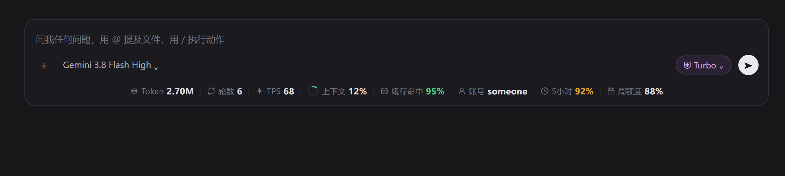
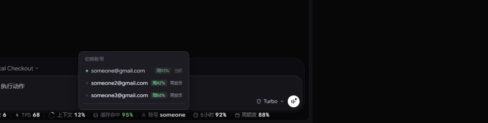
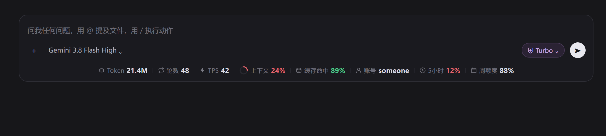

# Antigravity MiniBar
**输入框正下方的一行极简实时状态条** —— 在你打字的地方，一眼看全当前会话的健康度。
English | [简体中文](#功能一览)
[](https://github.com/dox0633/agy-minibar/actions/workflows/ci.yml)`n[](CHANGELOG.md)`n[](LICENSE)
[](#安装)
[](#适用对象)
[](#工作原理)

```
⬓ Token 2.70M  ⇄ 轮数 6  ⚡ TPS 68  ◯ 上下文 12%  🗄 缓存命中 95%  🕐 5小时 92%  📅 周额度 88%
```
---
## 这是什么
Google **Antigravity 2.0 桌面版**原生不显示任何会话状态——上下文快满了、额度快用完了，你都得自己猜。市面上的监控插件大多是右侧辅助面板或 IDE 状态栏，视线要离开对话框。
**MiniBar 不一样：它就贴在输入框正下方，居中一行小字。**
- **不占布局**：浮层定位（`position: fixed`），不挤占对话区、不推挤输入框、不触发宿主重排
- **鼠标穿透**：`pointer-events: none`，不会挡住任何点击
- **零依赖**：只用 Node.js 内置模块，不需要 `npm install`
- **纯本地**：只读取本机 transcript 日志和本地 Language Server RPC，不向任何外部服务发送数据
- **不改 asar**：通过官方 sidecar 插件机制 + CDP 注入，Antigravity 升级后无需重新适配
## 功能一览
显示顺序：**Token → 轮数 → TPS → 上下文 → 缓存命中 → 5小时 → 周额度**
| 指标 | 说明 | 数据来源 |
|---|---|---|
| ⬓ **Token** | 本会话累计消耗（`input + cache_read + output`），M 单位显示 | `transcript.jsonl` |
| ⇄ **轮数** | 当前会话的用户输入轮数 | `transcript.jsonl` |
| ⚡ **TPS** | 纯解码速度（`output_tokens ÷ streaming_seconds`，扣除首字等待），与 DSH 对话框下方 tok/s 同口径 | Language Server RPC |
| ◯ **上下文** | 圆环百分比，按**官方模型窗口**计算（Gemini 3/4 = 1,048,576；Claude = 200K；GPT-OSS = 128K） | `transcript.jsonl` |
| 🗄 **缓存命中** | 最近一次模型调用的 prompt cache 命中率 | `transcript.jsonl` |
| 🕐 **5小时** | 5 小时限额**剩余**百分比 | `RetrieveUserQuotaSummary` RPC |
| 📅 **周额度** | 每周限额**剩余**百分比 | `RetrieveUserQuotaSummary` RPC |
| 👤 **账号** | 当前账号显示；点击弹出账号面板，已备份 token 的账号**免重启热切换** | Windows Credential Manager |
### 账号热切换

状态条上的 **账号** 项显示当前登录的 Google 账号（邮箱前缀），点击弹出账号面板：
- **列表内容**：本机登录过的全部账号（来自 `~/.gemini/google_accounts.json` + 本地 token 库）
- **🟢 已存**：该账号 token 已备份在本地库，点击**免重启秒切**
- **⚪ 需登录**：该账号还没在本插件备份过 token，第一次切换时需完成一次 Google 登录
- **额度标签**：若检测到本机装过 Antigravity IDE（Kite 扩展），面板会显示各账号缓存的 **Gemini 周额度剩余**（如 \周93%\），一眼看出哪个账号还有余量
- **+ 登录新账号**：打开 Google 登录页；登录完成后状态条会出现「我已登录」确认条，点击即抓取 token 入库，此后永久秒切
**原理**：Antigravity 桌面版把活跃凭据存放在 Windows 凭据管理器（`gemini:antigravity`）。MiniBar 通过 CredRead/CredWrite 直接 swap 凭据 blob，并同步 `google_accounts.json` 与 `active-account.json` 两个指针文件——全程不修改 app.asar。
**切换生效时机**：凭据 swap 成功后插件**自动重启 Language Server**（宿主秒级拉起新实例），新实例直接读取目标账号凭据——设置菜单、配额池、状态条全部跟随，端到端约 10 秒，无需重启整个应用。
**安全说明**：
- token 库文件（`accounts.json`）只存放在本机用户目录，权限 0600，不上传任何服务器
- token 是 Google OAuth 凭据，与你在 Antigravity 里登录的权限完全一致；请勿分享该文件
- 切换前插件会自动把当前账号备份入库，任何时刻都能切回来
**合规提示**：

- 切换的是**本机已登录过**的账号，token 均来自你在 Antigravity 客户端中的正常登录，不涉及任何凭据生成或共享
- 多账号的配额相互独立（Google 侧按账号计量），请遵守 [Google 服务条款](https://policies.google.com/terms) 与 Antigravity 服务条款——本工具只做"本机已授权凭据的活跃切换"，不破解、不共享、不伪造凭据
- 若你的使用场景涉及团队共享账号池，请确认你拥有相应授权
- **圆环颜色跟 256K 自动压缩线**（262,144 tokens）而不是 1M 物理窗口——因为真正让你丢上下文的是压缩，不是物理上限：
  - 🟢 压缩线占用 < 80%
  - 🟡 ≥ 80%，开始留意
  - 🔴 ≥ 92%，下一轮可能触发自动压缩
- **5小时额度剩余 < 20%** 转红
**告警状态实拍**（上下文 24% 红 / 5小时 12% 红）：

- 空值一律显示 `—`，**宁可空着也不给假数据**（例如压缩步骤的耗时不会被误报为 TPS）
### 跟随切换对话
切换会话时 1 秒内跟随：立即清空旧会话的显示值，然后渲染新会话数据，绝不串数据。轮数与 Token 合计采用**字节偏移增量扫描**，会话文件再大也不卡顿。
### 主题自适应
自动检测输入框区域的明暗主题，深浅色两套配色，无需手动设置。
## 适用对象
| 适合你，如果你… | |
|---|---|
| 长时间使用 **Antigravity 2.0 桌面版**（`Antigravity.exe`） | ✅ |
| 想知道上下文离 256K 自动压缩还有多远，避免会话细节被压缩丢失 | ✅ |
| 关心 5h / 周额度还剩多少，安排长任务节奏 | ✅ |
| 想要 DSH 那种「对话框下方 tok/s」的体验 | ✅ |
| 使用 **Antigravity IDE**（VS Code 衍生版） | ❌ 请改用 [n2ns/antigravity-panel](https://github.com/n2ns/antigravity-panel) 等 IDE 扩展 |
| 期望云端账户总用量 / Google One 积分余额 | ❌ 这类数据不在本地 RPC 范围内 |
## 安装
### 前置要求
- **Antigravity 2.0 桌面版**（带 `~/.gemini/antigravity/` 数据目录的版本）
- 系统已安装 **Node.js ≥ 22.5**（只用于 sidecar 进程；无需任何 npm 依赖）
- **客户端启动参数**：Antigravity 启动时需附带 `--remote-debugging-port=0`（以开启本地 CDP 注入通道，生成 `DevToolsActivePort`；若使用快捷方式启动，可在目标末尾追加该参数）
### 方式一：git clone（推荐）
```powershell
# Windows PowerShell
git clone https://github.com/dox0633/agy-minibar.git "$env:USERPROFILE\.gemini\config\plugins\agy-minibar"
```
```bash
# macOS / Linux
git clone https://github.com/dox0633/agy-minibar.git ~/.gemini/config/plugins/agy-minibar
```
### 方式二：让 Antigravity 自己装
直接把下面这句话发给 Antigravity 对话框：
```text
把 https://github.com/dox0633/agy-minibar 克隆到 ~/.gemini/config/plugins/agy-minibar 并启用插件
```
### 启用
1. 重启 Antigravity（或打开左侧 **Customizations → Installed**，找到 `agy-minibar` 并开启）
2. 状态条自动出现在输入框正下方（首次出现约需 2~3 秒）
3. 侧边栏入口：对话窗口右上角 `⋮` → **Extensions** → **MiniBar**（提供状态总览）
### 验证
向 Antigravity 发送任意一条消息，等第一段回复流式输出完成，状态条应显示：
```
⬓ Token x.xxM  ⇄ 轮数 n  ⚡ TPS n  ◯ 上下文 x%  🗄 缓存命中 n%  🕐 5小时 n%  📅 周额度 n%
```
## 工作原理
```
┌────────────────────────── Antigravity 桌面版 ──────────────────────────┐
│                                                                        │
│  主窗口（React）                sidecar: node main.mjs                 │
│  ┌──────────────────┐          ┌─────────────────────────────┐         │
│  │  输入框          │◄─ CDP ───│ 1. 读 transcript.jsonl      │         │
│  │  [____________]  │  注入    │ 2. LS RPC: 速度/额度        │         │
│  │  ◯ 上下文 12% …  │          │ 3. 组装 payload             │         │
│  └──────────────────┘          └─────────────────────────────┘         │
│       ▲ Shadow DOM 浮层，挂 body，不进 React 节点树                      │
└────────────────────────────────────────────────────────────────────────┘
```
1. **Sidecar 进程**由 Antigravity 官方插件机制托管（`restart_policy: always`），崩溃自动重启
2. 每 1 秒轮询：
   - 解析 `~/.gemini/antigravity/brain/<conversationId>/.system_generated/logs/transcript.jsonl`（增量读取，只扫新追加字节）
   - 调用本地 Language Server RPC（`ANTIGRAVITY_LS_ADDRESS`，宿主注入的环境变量）：`GetCascadeTrajectoryGeneratorMetadata` 取 TPS、`RetrieveUserQuotaSummary` 取额度
   - 通过 **CDP**（`DevToolsActivePort`）把 payload 推进主窗口
3. 页面端 `inject.js` 以 **Shadow DOM** 渲染状态条，每轮更新前自检：清掉一切旧版本残留节点，保证全局只有一个实例
### 隐私
- 只读本机文件与本地回环 RPC，**零网络出站**
- 不写宿主任何配置文件，不碰 `app.asar`
- 唯一落盘文件是自身的 `minibar.log`（诊断用，位于插件目录内）
## 兼容性
| 平台 | 状态 |
|---|---|
| Windows 10/11 × Antigravity 2.0 桌面版 | ✅ 实机验证（v2.31.2 / 44.9.1） |
| macOS / Linux | ⚙️ 代码路径已按跨平台写（路径拼接用 `~/.gemini/`），未实测，欢迎反馈 |
| Antigravity IDE / JetBrains 插件 | ❌ 不同宿主，不适用 |
> Antigravity 大版本升级后，若输入框 `data-testid` 或 DevTools 端口机制变化，状态条会自动隐藏（不会报错、不会挡界面）；届时提 issue 即可。
## 故障排查
| 现象 | 处理 |
|---|---|
| 状态条不出现 | 确认插件已启用（Customizations → Installed）；打开一个**已有对话**的会话页（`/c/<id>`） |
| 一直显示 `—` | 当前会话还没有模型调用记录；先发一条消息等回复完成 |
| TPS / 额度是 `—`，其余正常 | Language Server RPC 未就绪；等几秒或重启 Antigravity |
| 数值看起来卡住 | 查看插件目录 `minibar.log` 是否有 `UNCAUGHT`/`UNHANDLED`；删掉日志重启 Antigravity |
| 与其他状态条插件冲突 | MiniBar 每轮自检清残留；若对方无自检逻辑，二选一启用 |
## 文档导航
| 文档 | 内容 |
|---|---|
| [功能与安装](#功能一览) | 指标表、告警规则、账号热切换 |
| [CHANGELOG](CHANGELOG.md) | 每个版本的完整变更记录 |
| [CONTRIBUTING](CONTRIBUTING.md) | 开发环境、强制约束、提交与发布流程 |
| [SECURITY](SECURITY.md) | 漏洞报告渠道、安全模型与数据边界 |
## 更新
```powershell
git -C "$env:USERPROFILE\.gemini\config\plugins\agy-minibar" pull --ff-only
```
拉取后重启 Antigravity 即可；页面端注入脚本带版本号自愈，旧版本残留会被自动清理。
## 卸载
1. **Customizations → Installed** 中关闭 `agy-minibar`
2. 删除插件目录：
```powershell
Remove-Item -Recurse -Force "$env:USERPROFILE\.gemini\config\plugins\agy-minibar"
```
3. 重启 Antigravity，状态条随之消失，无残留
## 致谢
- [jule-x/antigravity-context-monitor](https://github.com/jule-x/antigravity-context-monitor) —— transcript 解析库（`lib/transcript.mjs`）改编自此项目（MIT）
- [yuhuan-dev/antigravity-usage-monitor](https://github.com/yuhuan-dev/antigravity-usage-monitor) —— 顶栏胶囊与 CDP 多窗口挂载思路参考
- [Jayanyixing/dashboard-agy](https://github.com/Jayanyixing/dashboard-agy) —— 增量统计实现参考
- [LINUX DO](https://linux.do/) 社区 —— Antigravity 插件生态的交流与启发
## 许可证
[MIT](LICENSE) © agy-minibar contributors
